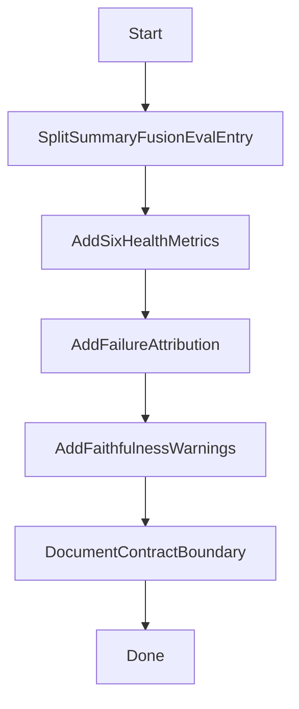

# Manager Phase-1 Implementation Plan

## Goal

Establish minimum observability for `manager_summary` and `manager_fusion` without tightening `manager` strategy semantics or reducing `global_plan` flexibility. Integrate these signals into current evaluation outputs for daily tracking and failure attribution.

## Required Boundaries

- Keep the current `manager_plan` evaluation approach; only additive extension is allowed.
- Guardrails are warning-only (no blocking, no automatic rollback).
- Do not implement Phase-2 items (judge-based or advanced semantic scoring).
- Do not modify the source plan artifact itself.

## Implementation Scope

- Evaluation aggregation/reporting: [d:/CS33-1/core/manager_prompt_eval.py](d:/CS33-1/core/manager_prompt_eval.py)
- Manager flow metadata attachment: [d:/CS33-1/agents/manager.py](d:/CS33-1/agents/manager.py)
- Summary/fusion split evaluation + metadata computation: [d:/CS33-1/agents/manager_retrieval.py](d:/CS33-1/agents/manager_retrieval.py)
- Standalone midlayer evaluation entry (summary/fusion only): [d:/CS33-1/main.py](d:/CS33-1/main.py) or a lightweight dedicated runner (follow current repo style)
- Documentation update (contract boundary + usage): [d:/CS33-1/docs/manager-prompt-eval-guide.md](d:/CS33-1/docs/manager-prompt-eval-guide.md)
- Lightweight regression checks: [d:/CS33-1/tests/test_window4.py](d:/CS33-1/tests/test_window4.py) or a style-consistent new test script

## Tasks

### Task 1: Split evaluation entry for `summary/fusion` (P0)

- Add independently callable `with_meta` capabilities in `manager_retrieval`:
  - `summary` returns output + parse/completeness metadata
  - `fusion` returns output + emptiness/repetition/code-leakage metadata
- In `manager` flow, attach these metadata blobs into internal `global_plan` fields for downstream report aggregation.
- Provide a standalone execution path that does not depend on full pipeline success.

**Acceptance Criteria**
- Same input can produce structured `summary` and `fusion` evaluation outputs independently.
- Existing main pipeline behavior remains intact.

### Task 2: Add 6 minimum health metrics to `manager_prompt_eval_latest` (P0)

- Extend `manager_prompt_eval` markdown + csv outputs with:
  - `summary_json_parse_ok`
  - `summary_required_fields_ok`
  - `summary_empty_rate`
  - `fusion_empty_rate`
  - `fusion_repetition_rate`
  - `fusion_code_leakage_flag`
- Keep backward compatibility (do not remove existing fields).

**Acceptance Criteria**
- New fields appear in `workspace/manager_prompt_eval_latest.md` and `.csv`.
- Timestamped historical outputs include the same fields.

### Task 3: Add failure attribution labels (P0)

- Implement a single-primary-label attribution rule in evaluation aggregation:
  - `manager_input_issue`
  - `manager_midlayer_issue`
  - `downstream_execution_issue`
- Output `failure_attribution_label`, `failure_owner`, and `failure_reason`.

**Acceptance Criteria**
- For `pipeline_success=false`, at least one primary attribution label is produced.
- Attribution can be traced to concrete report fields.

### Task 4: Lightweight faithfulness checks (P1, non-blocking)

- Add warning counters in `summary` metadata:
  - whether summary covers key task terms from `user_goal`
  - whether referenced fields exist in `df_preview`
  - whether `cleaning_hints` constraints are reflected when provided
- Output `faithfulness_warning_count` as observation-only.

**Acceptance Criteria**
- Warning count is visible in report outputs.
- No pipeline blocking behavior is introduced.

### Task 5: Contract boundary documentation (P1, non-blocking)

- In guide docs, clearly define active boundaries and non-tightened scope:
  - Active: top-level structure, `rules` type, `cleaning_contract` type, `max_row_drop_ratio` execution enforcement
  - Not tightened: no semantic hard constraints, no warning-to-blocking escalation

**Acceptance Criteria**
- Documentation consistently communicates “observability first, no premature tightening”.

## Recommended Execution Order

## Verification Checklist

- Run lightweight tests to verify new functions are callable and report fields are populated.
- Run standalone midlayer evaluation once to confirm independent outputs under downstream instability.
- Run one main pipeline pass (STUB/test data acceptable) to ensure no regression in main path.
- Check lints and resolve any introduced diagnostics.

## Deliverables

- Updated `manager_prompt_eval_latest.md/.csv` with 6 health metrics + attribution + warning fields.
- A standalone summary/fusion evaluation entry.
- Updated `manager-prompt-eval-guide` documenting contract boundaries and midlayer-only evaluation usage.
