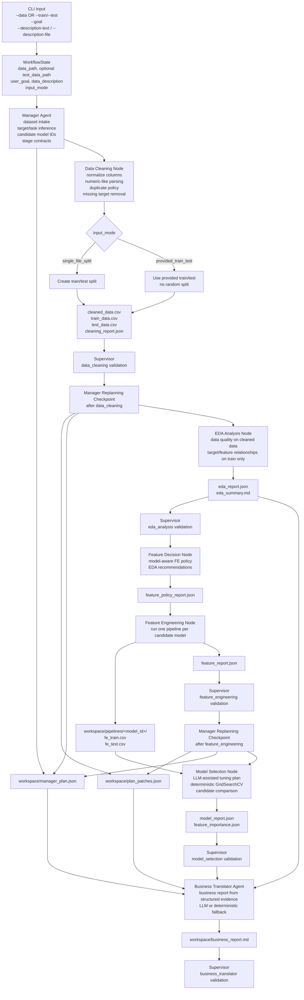

# Demo2 Architecture Design

## 1. Core Design Idea

The new project should move from an LLM-generated-code workflow to a tool-augmented multi-agent workflow.

In the previous design, worker agents relied heavily on the LLM to generate full Python scripts for data cleaning, feature engineering, and model selection. This was flexible, but unstable. A small prompt issue, wrong column assumption, or API failure could break the workflow or produce weak outputs.

The new design separates responsibilities:

- The LLM is responsible for understanding the user goal, making high-level decisions, and selecting suitable tools.
- Deterministic Python functions are responsible for data processing, validation, feature engineering, model training, and evaluation.
- The workflow state records structured reports, artifacts, and plan versions so that debugging and replanning are easier.

The target architecture is:

```text
Manager Agent
  -> task decomposition
  -> stage contracts
  -> checkpoint-based replanning

Worker Agents
  -> local planning
  -> tool selection
  -> deterministic execution
  -> structured stage report

Feature Decision Node
  -> decide whether feature engineering is needed
  -> choose skip / light / standard / task-specific mode

Supervisor Agent
  -> artifact validation
  -> contract checking
  -> quality review
  -> retry or pass decision

Business Translator Agent
  -> final business-facing report
  -> evidence-based recommendations
  -> optional LLM generation with deterministic fallback
```

## Current Workflow Graph



Main leakage boundary:

- Feature-target EDA uses `train_data.csv` only.
- Feature engineering fits imputers, encoders, scalers, clipping bounds, and correlation filters on train data, then applies compatible transforms to test data.
- Provided test data is used for final evaluation only when it includes the target column.

## 2. Manager Agent

The Manager Agent should not write detailed operational plans for every worker agent at the beginning. Instead, it should define the overall task and stage-level contracts.

The Manager is responsible for:

- Understanding the user goal.
- Identifying the likely task type, such as classification, regression, forecasting, clustering, or descriptive analysis.
- Defining the expected target column if the task is supervised.
- Defining stage boundaries and required outputs.
- Defining quality requirements for each stage.
- Updating downstream plans only when structured stage reports show that replanning is needed.

The Manager should output a structured global plan such as:

```json
{
  "task_summary": {
    "business_goal": "Predict customer churn and provide retention recommendations",
    "task_type": "classification",
    "target_column": "churn",
    "primary_metric": "f1",
    "initial_feature_engineering_policy": {
      "mode": "light",
      "can_be_skipped": true,
      "decision_required_after_cleaning": true,
      "reason": "Tree-based models may only need basic encoding and missing-value indicators."
    },
    "risk_notes": ["Check class imbalance before modelling"]
  },
  "stage_contracts": {
    "data_cleaning": {
      "goal": "Produce a clean dataset while preserving target semantics",
      "required_outputs": ["cleaned_data.csv", "cleaning_report.json"],
      "quality_requirements": [
        "No duplicate rows",
        "No all-empty columns",
        "Target column must be preserved",
        "Row loss must be justified"
      ]
    },
    "feature_engineering": {
      "goal": "Decide and apply the necessary level of feature engineering based on cleaned data, task type, and model family",
      "required_outputs": ["fe_train.csv", "fe_test.csv", "eda_report.json", "feature_policy_report.json"],
      "quality_requirements": [
        "Feature engineering mode must be justified",
        "Train/test columns must match",
        "No target leakage",
        "Class imbalance must be reported if classification"
      ]
    },
    "model_selection": {
      "goal": "Train and evaluate suitable models for the detected task",
      "required_outputs": ["model_report.json", "feature_importance.json"],
      "quality_requirements": [
        "Use an appropriate metric",
        "Compare baseline and candidate models",
        "Report test-set performance"
      ]
    }
  }
}
```

## 3. Worker Agents

Worker agents should no longer rely on the LLM to write complete scripts from scratch.

Each worker should:

- Read the current stage contract.
- Inspect the actual input artifact.
- Create a local tool plan.
- Select functions from a predefined tool registry.
- Execute deterministic functions.
- Write structured reports for the Supervisor and Manager.

Example tool plan:

```json
{
  "stage": "data_cleaning",
  "selected_tools": [
    {
      "name": "drop_duplicate_rows",
      "params": {}
    },
    {
      "name": "impute_missing_values",
      "params": {
        "numeric_strategy": "median",
        "categorical_strategy": "mode"
      }
    },
    {
      "name": "parse_datetime_columns",
      "params": {
        "columns": ["order_date"]
      }
    }
  ]
}
```

The worker then executes the selected tools from a registry:

```python
for step in tool_plan["selected_tools"]:
    tool = TOOL_REGISTRY[step["name"]]
    df = tool(df, **step["params"])
```

This makes the system more stable because the LLM chooses what to do, while project-owned functions control how it is done.

## 4. Conditional Feature Engineering

Feature Engineering should be a conditional stage, not a fixed heavy-processing step.

Some models and tasks do not need complex feature engineering. For example, tree-based models such as Random Forest, XGBoost, and LightGBM usually do not require scaling and can handle non-linear relationships well. For clean structured datasets, light encoding and missing indicators may be enough. For text, image, clustering, or time-series tasks, generic tabular feature engineering may be inappropriate or should be replaced by task-specific processing.

The workflow should include a Feature Decision Node:

```text
Manager initial plan
  -> defines task type, target, model preference, initial FE policy

Data Cleaning Worker
  -> outputs cleaned data and data profile

Feature Decision Node
  -> reads task summary, cleaned data profile, and model candidates
  -> decides final FE mode

Feature Worker
  -> executes selected FE tools or pass-through behavior
```

Recommended feature engineering modes:

```text
skip
  Use cleaned train/test data directly after validating schema.

light
  Apply basic encoding, missing indicators, and datetime extraction when useful.

standard
  Apply encoding, scaling, transformations, and simple interactions.

task_specific
  Apply task-aware processing, such as time-series lags, rolling windows, text vectorization, or aggregation features.

model_specific
  Prepare data based on selected model family, such as tree-based models, linear models, or distance-based models.
```

Example FE policy:

```json
{
  "feature_engineering_policy": {
    "mode": "light",
    "reason": "The selected model family is tree-based and the cleaned dataset is already structured.",
    "required_tools": [
      "encode_categorical_columns",
      "create_missing_indicators",
      "create_datetime_features"
    ],
    "skipped_steps": [
      "scaling",
      "polynomial_features"
    ]
  }
}
```

The Manager should provide only an initial policy. The Feature Decision Node should make the final decision after data cleaning, because it can inspect the real cleaned data profile.

The Supervisor should verify that the selected FE mode is justified. If FE is skipped, the workflow still needs a `feature_policy_report.json` explaining why the cleaned data is already suitable for modelling.

## 5. Tool Layer

The `tools/` directory should contain deterministic functions used by agents.

Recommended modules:

```text
tools/
  data_cleaning_tools.py
  feature_engineering_tools.py
  model_selection_tools.py
  validation_tools.py
```

Examples:

- `detect_missing_values(df)`
- `impute_missing_values(df, numeric_strategy, categorical_strategy)`
- `drop_duplicate_rows(df)`
- `infer_column_types(df)`
- `detect_class_imbalance(y)`
- `recommend_feature_engineering_policy(task_type, model_family, data_profile)`
- `encode_categorical_features(train_df, test_df, strategy)`
- `scale_numeric_features(train_df, test_df, strategy)`
- `pass_through_features(train_df, test_df)`
- `create_datetime_features(train_df, test_df, columns)`
- `create_time_series_features(train_df, test_df, time_column, group_columns)`
- `select_candidate_models(task_type)`
- `cross_validate_models(models, X, y, metric)`
- `evaluate_on_test_set(model, X_test, y_test, metric)`
- `validate_artifact(path, expected_type)`

The tool layer should be unit-tested independently from the LLM workflow.

## 6. Supervisor Agent

The Supervisor should not only read natural-language logs. It should validate structured outputs and artifacts.

The Supervisor should check:

- Whether required files exist.
- Whether files are fresh and non-empty.
- Whether CSV files are readable.
- Whether train/test schemas match.
- Whether feature engineering mode is justified.
- Whether skipped feature engineering still produced valid model-ready artifacts.
- Whether the target column is preserved when required.
- Whether class imbalance was reported for classification tasks.
- Whether model metrics are compatible with the task type.
- Whether the stage output satisfies the Manager contract.

The Supervisor can still use an LLM for judgement, but deterministic validation should happen first. If deterministic validation fails, the stage should fail directly.

For the Business Translator stage, Supervisor validates that `workspace/business_report.md` exists, has meaningful length, and contains the required business-report sections.

## 7. Checkpoint-Based Replanning

Dynamic replanning is useful, but it must be controlled.

The Manager should only replan at fixed checkpoints:

```text
Initial Manager Plan
  -> Data Cleaning Agent
  -> Data Cleaning Report
  -> Supervisor
  -> Manager Replanning Checkpoint
  -> Feature Decision Node
  -> Feature Engineering Agent
  -> Feature Engineering Report
  -> Supervisor
  -> Manager Replanning Checkpoint
  -> Model Selection Agent
```

Rules for replanning:

- Replanning must be based on structured stage reports.
- The Manager can only update downstream stage contracts.
- The Manager cannot rewrite facts from completed stages.
- The Manager should output a small patch, not a full new plan.
- Every patch should be versioned and saved.
- Patch records are written to `workspace/plan_patches.json`.

Example plan patch:

```json
{
  "plan_version": 2,
  "reason": "Data cleaning detected class imbalance and high missingness in income.",
  "updates": {
    "feature_engineering": {
      "quality_requirements": [
        "Create missingness indicator for income",
        "Preserve target column churn",
        "Report class imbalance in EDA"
      ]
    },
    "model_selection": {
      "primary_metric": "f1",
      "imbalance_strategy": "class_weight_or_resampling"
    }
  }
}
```

This avoids chaotic replanning while still allowing the workflow to adapt to real data conditions.

Current deterministic replanning checkpoints:

- After Data Cleaning: update downstream requirements when the cleaned profile shows class imbalance or high-missingness columns.
- After Feature Engineering: update Model Selection requirements when the feature table is high-dimensional or FE was skipped.

## 8. Recommended Implementation Order

1. Build the project skeleton and shared state schema.
2. Implement deterministic validation tools first.
3. Implement data cleaning tools.
4. Implement feature engineering policy tools.
5. Implement feature engineering execution tools.
6. Implement model selection tools.
7. Implement worker agents that call tool registries.
8. Implement the initial Manager Agent plan schema.
9. Implement Supervisor deterministic validation.
10. Add checkpoint-based Manager replanning.
11. Add Business Translator and final report generation.

## 9. Main Expected Benefits

- Better stability because core operations are deterministic.
- Better accuracy because tool behavior is tested and reusable.
- Better debugging because every stage writes structured reports.
- Better adaptability because Manager can replan based on actual stage outputs.
- Better modelling flexibility because feature engineering can be skipped, reduced, or made task-specific.
- Better evaluation because Supervisor validates artifacts and contracts, not only logs.

## 10. LLM Integration

The initial LLM integration is limited to the Business Translator Agent.

The data science workflow still runs through deterministic tools. The LLM is only used to translate structured evidence into a business-facing markdown report. If the LLM is not configured or the call fails, the Business Translator writes a deterministic fallback report instead of blocking the workflow.

Configuration is OpenAI-compatible and can be set in `.env`:

```text
OPENAI_API_KEY=your_api_key_here
OPENAI_MODEL=gpt-4o-mini
OPENAI_BASE_URL=optional_openai_compatible_base_url
LLM_TEMPERATURE=0.2
```

Business Translator output:

```text
workspace/business_report.md
```

The report is generated from:

- `global_plan`
- `stage_reports`
- `workspace/model_report.json`
- `workspace/feature_importance.json`
- `plan_patches`
